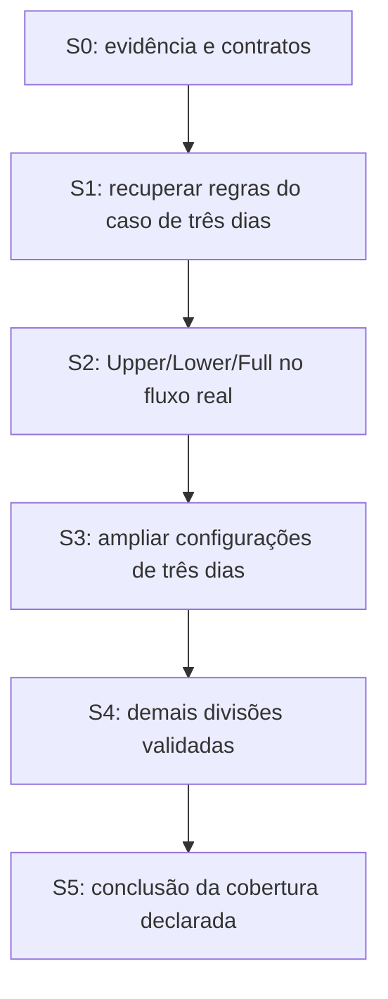

# Plano 073: implementação das regras de geração recuperadas

**Estado:** contrato aprovado em 15/10/2026; S0 iniciada com suplemento offline,
verificador e auditorias. A pesquisa S1 liberou o domínio inicial; S2 iniciada
conforme [contrato de implementação](073/initial-generation-contract.md).
A aceitação funcional ainda depende do fluxo completo.
**Issue:** [#421](https://github.com/pedrochagasmaster/repforge/issues/421).
**Spec:** [fechamento dos gaps de geração](../docs/generator-rule-parity-spec.md).
**Base examinada:** `d0242c4679ba6a00cea6fd48f42450f3b6e93322`.
**Fila:** [backlog canônico](../docs/backlog.md), item de convergência condicionado
à evidência. Não cria uma promessa de prazo nem altera o gate de lançamento 059.

Um programa determinístico com regras recuperadas é o resultado único deste
plano. Etapas são unidades revisáveis desse resultado, não uma segunda fila.
Não implementar fórmulas de progressão/carga/fadiga ou uma reescrita de plataforma.

## Estado da execução

Três chats GPT-6.1 Sol, reasoning Low, executaram a primeira rodada sob
coordenação em worktree isolado. O [suplemento S0](073/README.md) tem extrator,
verificador, seis mutações de conteúdo e dois casos de chaves JSON duplicadas. O [contrato determinístico](073/deterministic-contract.md)
registra entradas, identidade e consumidores; a [auditoria S1](073/rule-recovery-status.md)
registra regras parciais, bloqueios e próximas janelas. O replay dos seis scripts
históricos em um diretório novo reproduziu 53 saídas byte a byte e preservou
96 hashes de fontes e o estado de três checkouts. Isso reproduz os decodificadores
simbólicos existentes; não é execução do gerador original nem nova transcrição
visual. O corpus original e os checkouts com alterações locais foram preservados.

Após a remoção autorizada de uma cópia temporária de CI, o espaço voltou a superar
o piso de 4 GiB. A recuperação prosseguiu com janelas limitadas e um leitor de
metadados ligado aos objetos de compilação já existentes. Não houve full pass
Blutter. A revisão independente aceitou o intercalamento de listas no domínio
registrado e as correções dos verificadores de doses locais. As provas posteriores cobrem componentes de compatibilidade ULF, região efetiva,
ranking, músculos, spillover, trocas e conversão de séries em templates. A composição
local explica condicionalmente 18 exercícios e 45 séries para entradas explícitas,
sem provar o programa final. Depois do reset, os mesmos chats Low retomaram e
revisaram ordem, distribuição, equipamento, histórico, ranking e ciclos. O gate
de pesquisa está fechado para o primeiro domínio parametrizado do contrato
inicial. S2 começou com provas puras escritas antes dos módulos e com o red real
das oito despriorizações. A nova opção só será exposta após a cadeia completa.
A [auditoria S1](073/rule-recovery-status.md) registra os fechamentos e distingue
os limites históricos, os inputs desconhecidos de Godmode2 e as provas de produto
que ainda faltam.

## 1. Base e matriz de gaps

As referências abaixo descrevem o SHA da base, não nomes privados que os testes
devem congelar. Revalidar os donos ao iniciar cada etapa. Entre o levantamento
`ac4ffcf` e esta base só mudaram i18n, service worker e teste de i18n; os anchors
da engine permanecem iguais.

| Gap | Situação atual / dono | Evidência ou decisão | Trabalho para fechar | Gate |
| --- | --- | --- | --- | --- |
| G01: identidade determinística | `program-compiler.js`: `seedRank`, `compareCandidates`; request/seed em review e sharing | D01/D02 aprovadas; seed variável atual não satisfaz o novo contrato | Requisição canônica, desempate total, identidades e consumidores sem aleatoriedade oculta | A01, A10 |
| G02: default e escolha de split | `automaticSplit`: 2/3 → full_body; `SPLITS` não contém Upper/Lower/Full | E02 recupera defaults; domínio de seleção explícita requer validação | Mapeamento entre IDs, compatibilidade, opção automática/explicita na UI | A02 |
| G03: contrato dos dias | `prepareJobs`, `distributeJobs` redistribuem tarefas de quatro dias | E01 recupera ordem e listas; semântica adicional parcial | Decodificar campos +0x10/+0x14 e sua relação com templates, sem converter roles em contagem fixa | A03 |
| G04: distribuição e sobras | Mesmos helpers; balanceamento escolhido por séries | Fluxos de distributeTemplates, roundRobin, fits, score e spillover parciais | Recuperar critérios, ordem, desempates e casos de insuficiência/excesso | A03, A06 |
| G05: duração | `TIME_CEILINGS`, `fitProgramTime`, `estimateSlotSeconds`; adapter arredonda duração para teto | E02 recupera 18/30/50/75/105/125; modelo de custo e TimeCalcAllocation incompletos | Separar opção/orçamento/estimativa e recuperar alocação; retirar corte antigo só com substituto validado | A04 |
| G06: filtros | `candidateFailure`, `equipmentContexts`, prerequisites | Catálogo exato; vários operadores/políticas ainda inferidos | Rastrear filtros e combinações; preservar restrições duras aprovadas | A06 |
| G07: ranking | tier → preferência → hash seed; código original tem seleção pseudoaleatória | E05 recupera seleção por índice, não o ranking completo | Recuperar ranking; substituir apenas escolha aleatória por desempate estável próprio | A01, A06 |
| G08: séries/reps/RIR | `stableRepRange`, `buildSetPrescription`, jobs P1–P4 | E03 fornece observações, não fórmula geral | Recuperar criação de ExerciseTargetSet/CycleTarget, regras por role e posição | A03, A07 |
| G09: músculos | `applyEmphasis` só itera priorizados; adapter `.slice(0,5)`; validator limita cinco | E03 observa zero priorizados/oito despriorizados | Remover perda de entradas e recuperar efeito independente/limites reais | A05 |
| G10: cobertura de divisões | Quatro famílias de split no Taurifer | 13 enums identificados; contratos executáveis incompletos | Validar cada divisão e frequência antes de expor sua opção | A09 |
| G11: dimensões de prescrição | Objetivo, experiência, períodos, deload: políticas 067 | Observação both/Advanced/Static; demais efeitos ainda incompletos | Recuperar ramos e testar ciclos/limites, sem extrapolar Cycle 1 | A07 |
| G12: consumidores | adapter, entry, worker, review, app, shared-setup | D01/D06; baseline e chaves ainda incluem seed | Convergir todas as entradas e consumidores na mesma definição canônica | A01–A03 |
| G13: quebra e dados | loaders/imports/drafts/recipes atuais | D05/D09 dispensam backward compatibility, preservam dados legíveis | Inventariar o que quebra, recusar versões, preservar bytes e implementar reset explícito onde necessário | A08 |
| G14: evidência e orientação | Plan067/unknowns ainda contêm afirmações de controle de fluxo não recuperado | E01–E05; spec aprovada | Suplemento sanitizado, catálogo de regras e testes adversariais; atualizar documentação sem reescrever história | A10 |

G02 e a conversão de G05 têm evidência estática reproduzível. Isso não encerra
G03/G04/G06–G11 nem libera a primeira etapa funcional isoladamente.

## 2. Arquitetura de implementação

Manter a fronteira pura do compilador. O adaptador converte escolhas do usuário
em uma requisição canônica, sem descartar dados. O compilador resolve divisão,
orçamento, templates, candidatos, distribuição, alvos e definição final.
Renderização, storage e worker consomem esse contrato; não replicam políticas.

As regras recuperadas devem ter identidade, domínio de aplicação e proveniência
versionados. Isso pode ser implementado dentro dos módulos existentes. Não
criar uma framework de regras ou vários geradores paralelos para contornar gaps.
Durante a entrega gradual, configurações não substituídas mantêm a política
vigente sob a versão corrente, com cobertura de pesquisa explicitamente pendente.
Não embarcar cópias de engines antigas para reproduzir versões passadas.

Fixar a serialização canônica e o comportamento de desempate antes de escrever
os testes de identidade. Se houver hash/seed derivada, definir preimage, campos
incluídos, exclusões de metadados e fallback determinístico para colisões. Não
usar `localeCompare` dependente do ambiente para o desempate final por ID.
O caminho de execução ou duração da busca não pode escolher um resultado diferente.

Separar a chave do resultado gerado da identidade de uma ativação e do log de
edições do review. Revisar `program-entry.js`, `program-entry-adapter.js`,
`program-engine.js`, `program-review.js`, `app.js` e `shared-setup.js`.
Reaproveitar os mecanismos reais de cancelamento, resultado obsoleto, revisão e
ativação. O catálogo permanece o artefato local gerado por sua ferramenta atual.

## 3. Sequência e dependências

Pesquisa independente de S3/S4 pode ocorrer antes, preservando fontes. A ordem
de entrega funcional mantém Upper/Lower/Full primeiro. Cada PR precisa ser
coerente; nenhum PR parcial recebe rótulo de etapa encerrada.

### S0. Preparar evidência e contratos, sem alterar a engine

1. Registrar SHA atual, alterações locais e hashes dos artefatos privados.
   Preservar originais, fontes Blutter modificadas e evidências anteriores.
2. Reproduzir E01/E02 e a normalização E03 em diretório de saída isolado.
   Comparar hashes, instruções/offsets e decisões com as fontes. Não executar
   novamente o full pass Blutter que falhou; usar janelas e limites explícitos.
3. Criar suplemento sanitizado de E03 e contratos extraídos, seguindo o allowlist
   do pacote 067. Provar com controles negativos que dados pessoais extras,
   proveniência ausente e valores adulterados são rejeitados pelo verificador.
4. Registrar cada regra com: ID, fonte/hash, trecho/endereço ou células, domínio,
   pressupostos, condições, saída esperada, exceções, dependências, classificação,
   prova e limitações. Manter os G-IDs para rastrear fechamento.
5. Fixar R01/R08 e o inventário de consumidores antes de mudar schema ou geração.
   Enumerar falhas combinatórias que exigem teste puro e escrever sua prova
   falhando antes da implementação, conforme a política do repositório.

**Saída:** corpus revisável, contrato de aceitação e gates por regra. Integridade
do pacote não libera UI nem declara paridade. E01/E02 usam avaliação simbólica,
cujo modelo precisa ser auditado contra o ARM64; não chamá-la de execução Dart.

Os originais ficam no acervo privado `rea-investigation-20261014`. Localizar pelo
handoff `CODEX_HANDOFF_GODMODE2_DELTA_2026-10-15.md`. Fontes pertinentes:
`continuation-20261015-split-contract/` e `godmode2-20261015/`. Scripts atuais
`normalize.py`, `recover_auto_split.py`, `build_fixture.py` e `verify.py` são
receitas privadas de reprodução, não ferramentas já publicadas no repo. Revisar
seus caminhos de saída antes de rodar; nunca sobrescrever a evidência original.
O ambiente de pesquisa deve manter ao menos 4 GiB livres e preservar processos
e worktrees ativos. Acesso autenticado ao backend não faz parte deste plano.

### S1. Recuperar a cadeia necessária ao primeiro caso

Usar o contexto observado Godmode2: três dias, both, Advanced, Static, faixa
40–60, sem deload, zero priorizados, oito despriorizados e perfil comercial
exportado. Separar configurações confirmadas de hipóteses de associação.
Campos desconhecidos de avaliação, descanso, edição e estado interno permanecem
desconhecidos; novos casos controlados ou código devem resolver os relevantes.

Prioridade de investigação:

1. Campos adicionais de SplitDay e distribuição: `distributeTemplates`
   `0xede57c`, `roundRobin` `0xedd5a0`, `spillover` `0xedd980`, `fits`
   `0xed8edc`, `score` `0xed8f64`.
2. TimeCalcAllocation e dependências do orçamento interno de 50 minutos.
   Distinguir fator de split, fator de objetivo, arredondamento e erro de tempo.
3. Criação de alvos em `0xedb328..0xedcb0c`, incluindo ExerciseTargetSet e
   CycleTarget. Identificar sets/reps/RIR e a ligação ao objetivo/experiência.
4. Filtros e ranking anteriores à seleção de `getBestMatch` `0xee1a68`.
   Localizar o ponto exato onde o desempate determinístico Taurifer substitui
   a seleção aleatória, sem mudar a classificação dos candidatos.
5. Efeito e domínio de despriorização sem priorização; restrições e defaults
   ainda usados pelo primeiro caso. Não assumir que o perfil exportado é uma
   fotografia transacional de todas as entradas do gerador.

**Gate para S2:** G02–G09 e G11 têm todas as regras necessárias ao domínio inicial
recuperadas e validadas. Regra parcial ou entrada influente ainda desconhecida
mantém o caso correspondente pendente. Registrar precisamente o domínio liberado;
não declarar todos os objetivos e períodos cobertos por provar um só.

### S2. Implementar a primeira fatia completa

**Primeira prova de maior risco:** entradas reais de três dias e oito músculos
despriorizados atravessam o formulário, adapter, worker e compilador sem perda;
produzem a definição validada Upper/Lower/Full; review, ativação, Focus e reload
preservam dias e alvos. Esta prova detecta a falha de acrescentar apenas um enum
ou renomear três dias de um programa Full Body.

Implementar em unidades coerentes:

1. Requisição canônica e identidade determinística comum aos consumidores,
   com provas puras de permutações, ordem semântica, colisões e inputs ausentes.
2. Regras de divisão, distribuição, orçamento, filtros, ranking, doses e
   despriorização do domínio validado, incluindo respostas de conflito.
3. Entrada e review com opções reais, rebuild/undo, estimativa separada do
   orçamento e comportamento de cancelamento/resultado obsoleto.
4. Ativação e consumidores da definição; versão, receitas/imports atuais e
   comportamento de formatos incompatíveis conforme R08.

Se for necessário integrar código preparatório, ele não expõe a nova opção até
que a cadeia completa passe. Não criar uma combinação silenciosa de distribuição
nova com dosagem antiga que ainda não tenha sido validada como conjunto.

**Aceitação:** A01–A06, A08 e A10 para o domínio inicial, mais A07 no caso Static
e sem deload validado. Provar o caso observado e casos independentes capazes de
falhar por regra errada. A correspondência de exercícios sorteados não é oracle.
Contagens 18/45 só serão exigidas se a regra e as entradas controladas demonstrarem
que são invariantes do caso, independentemente da escolha determinística.

### S3. Ampliar as configurações de três dias

Recuperar e validar os ramos restantes de objetivo, experiência, faixas de tempo,
equipamentos, preferências, periodização e deload para Upper/Lower/Full. A matriz
de cobertura deve enumerar valores discretos e interações relevantes antes de
implementar cada extensão. Não presumir que um resultado correto em Static vale
para Linear, Reverse Linear ou Undulating.

Cobrir extremos de duração e equipamento, nenhuma/uma/várias prioridades,
despriorização isolada, preferidos elegíveis/inviáveis e ciclos com/sem deload.
Usar casos de fronteira e propriedades combinatórias para interações que um
pequeno conjunto de exports não cobre. Generalizações precisam da regra executável.

**Aceitação:** A01–A08/A10 no domínio ampliado; ramos pendentes permanecem nomeados.
Não há alteração das fórmulas de carga/fadiga para satisfazer essa etapa.

### S4. Adicionar as demais divisões

Para cada uma das outras identidades de R02, repetir recuperação do contrato,
compatibilidade de frequência, distribuição, seleção e doses; só então integrar
no seletor. Priorizar o próximo menor conjunto de dependências já comprovadas.
O plano não atribui equivalência a uma divisão apenas porque tem o mesmo número
de dias de outra. Full Body exige confirmar seu domínio variável.

Cada fatia deve demonstrar default e escolha explícita, nome/ordem dos dias,
restrições, ciclos e consumidores de produção. P1–P4 ajudam a conferir quatro
dias, mas não substituem código para todas as configurações. Revalidar A01–A10
nas regras compartilhadas afetadas, sem repetir indiscriminadamente todos os
testes locais já verdes.

### S5. Encerrar o escopo declarado

Conferir a matriz de G01–G14 e cada linha de R02. Toda configuração anunciada
como coberta tem regra, testes de condições/limites e prova de integração.
Pendências não são convertidas em aproximações para encerrar o plano.

Remover o caminho substituído quando seus consumidores tiverem migrado, sem
manter engines legadas por compatibilidade. Reconciliar os documentos abaixo,
limpar expectativas de testes que congelavam políticas antigas e encerrar as
linhas correspondentes do backlog. Se alguma divisão continua bloqueada,
reportar as etapas concluídas e manter o plano global em andamento.

## 4. Donos das provas

A tabela abaixo registra os donos previstos na base. A implementação S2 e suas
provas estão em [estado da implementação](073/implementation-status.md). As
provas locais já executadas não substituem o gate de CI no head final. Os controles
offline de S0 estão registrados no suplemento.

| Contrato | Donos de teste a ampliar/substituir | Violação que a prova deve detectar |
| --- | --- | --- |
| A01 | `test/program-compiler-plan067.mjs`, `test/program-engine-worker.mjs`, `test/generative/properties/program-compiler.mjs` | Seed oculta, locale/ordem incidental, fallback diferente, resultado worker obsoleto |
| A02/A05 | `test/program-entry-production-adapter.mjs`, `test/program-entry-inputs.mjs`, `test/program-entry-contracts.mjs`, `test/generate-program-browser.mjs` | Auto três dias Full Body, override perdido, oitavo músculo truncado |
| A03 | `test/generate-program-browser.mjs`, `test/program-entry-s4.mjs`, `test/program-day-names-browser.mjs`, `test/adaptive-workout-browser.mjs` | Dias apenas renomeados, doses alteradas na ativação ou no reload |
| A04/A07 | `test/program-compiler-plan067.mjs`, propriedades do compiler, jornada de geração | 60 usado no lugar de orçamento 50, fórmula antiga de corte, extrapolação inválida de ciclos |
| A06 | `test/program-compiler-search.mjs`, jornada de geração | Equipamento/exclusão ignorados, pool vazio apresentado como sucesso, timeout apresentado como impossibilidade |
| A08 | `test/shared-setup-unit.mjs`, `test/share-program-browser.mjs`, `test/program-import-review.mjs`, provas de draft/persistência conforme fronteira alterada | Receita antiga reinterpretada, bytes perdidos no boot, reset sem ação explícita ou cancelamento que escreve |
| A09 | Donos A02/A03/A07 e `test/program-day-names.mjs` | Opção exibida antes de estar validada; dia incompatível aceito |
| A10 | Suplemento de evidência com controles negativos em S0; `plans/067/verify.py` permanece dono do pacote original | Dados privados copiados, classificação de hipótese como regra, snapshot circular usado como prova |

Antes de testes isolados, enumerar o risco que o browser não exercita de forma
determinística: serialização canônica, permutações, domínio combinatório e falhas
de protocolos são candidatos. Escrever a prova falhando antes da mudança. Não
testar nomes privados de helpers nem apenas procurar strings no código.

Usar o runner e a seleção atuais em [docs/ci.md](../docs/ci.md). Em implementação,
prova focada, revisão independente e `ci` verde no head final são evidência de
conclusão. `edit`/`packet` são feedback; não executar `candidate` completo como
rotina local. Evidências precisam de SHA, comando, fixture e resultado, conforme
[implementation-evidence](../docs/agents/implementation-evidence.md).

Mudanças visíveis exigem captura e revisão dos estados afetados no catálogo UI.
Atualizar i18n pelas fontes e regenerar; arquivos em cache exigem revisão do
inventário e bump do cache na implementação. Não há motivo para executar essas
ações no suplemento offline de S0.

## 5. Registro de aceitação por etapa

Antes do primeiro código de cada etapa, preencher no PR:

| Campo | Conteúdo obrigatório |
| --- | --- |
| Identidade | SHA base/head, versão do gerador e fingerprint do catálogo |
| Domínio | Divisões, frequências, objetivos, experiência, duração e demais configurações cobertas |
| Dependências | G-IDs e rule IDs necessários, estado da evidência e bloqueios restantes |
| Regra | Fonte, hash, condições, pressupostos e classificação |
| Prova | A-ID, produtor/consumidor real, comando, local da asserção, caso que deve falhar |
| Quebras | Formatos afetados, dados preservados e comportamento de recusa/redefinição |
| Resultado | Evidência executada ou motivo de pendência; não preencher com expectativa |

Não transformar os IDs dessa tabela em um checker que apenas verifica palavras
ou presença de arquivos. Os assertions precisam distinguir a regra correta de
uma implementação plausível porém errada.

## 6. Reconciliação e limites operacionais

Esta entrega adiciona pointers prospectivos ao Plano 067, seu pacote/unknowns,
Planos 070/072, índice e backlog. A implementação atualizará a descrição do
comportamento vigente em `AGENTS.md`, ADR 0007 e contratos de review/sharing
quando o novo caminho realmente existir. Não declarar alteração executada em
documento de arquitetura atual antes do código.

O material bruto da investigação não entra no Git. Nomes relativos, hashes,
conclusões revisadas e fixtures de campos permitidos sustentam o suplemento.
Gaps de fonte exigem investigação, não respostas do usuário para fatos que
podem ser recuperados. Decisões de produto Q1–Q12 estão encerradas; só um novo
conflito de produto fora desse contrato exige reabrir a entrevista.

Sem mudança de engine nesta entrega, nenhum teste de paridade da aplicação foi
declarado aprovado. A publicação do suplemento para revisão não libera uma etapa funcional.
Não fazer merge ou liberar a engine por ter apenas documentação e corpus válidos.
